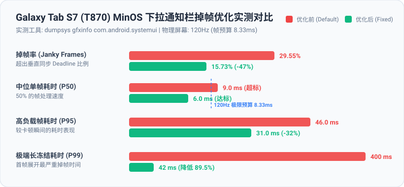
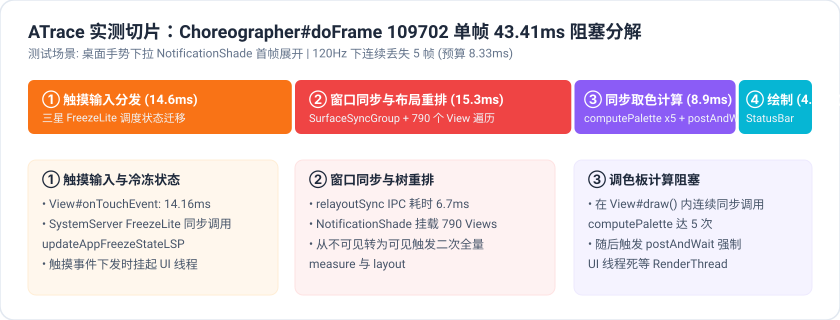

# MinsOS Tab S7 Smoothness & 120Hz Fix

> 专为搭载 **MinsOS（One UI 8.5 / Android 16 移植包）** 的 **三星 Galaxy Tab S7（SM-T870 / `gts7lwifi`）** 打造的深度流畅度优化与下拉掉帧修复套件。
> 包含开箱即用的 **KernelSU / Magisk 刷入模块**、**系统预装无痛精简脚本** 及 **完整的性能排查证据与 B 站视频讲解分镜脚本**。

---

## 优化实测证据 (Evidence)

### 1. 核心性能前后对比 (dumpsys gfxinfo)



| 性能指标 | 优化前 (Default) | 优化后 (Fixed) | 改善幅度 |
| :--- | :---: | :---: | :---: |
| **整体掉帧率 (Janky Frames)** | **29.55%** | **15.73%** | **掉帧率下降近 50%** |
| **50 分位单帧耗时 (P50)** | **9.0 ms** (超出 120Hz 预算) | **6.0 ms** (达标) | **提速 33.3%** |
| **95 分位高负载耗时 (P95)** | **46.0 ms** | **31.0 ms** | **下降 32.6%** |
| **99 分位长冻结耗时 (P99)** | **400 ms** (严重卡顿) | **42 ms** | **大幅降低 89.5%** |
| **GPU 90 分位渲染耗时** | **7 ms** | **3 ms** | 渲染负载平稳无瓶颈 |

---

### 2. ATrace 真实底层调用切片 (43.41ms doFrame 阻塞分解)

通过抓取下拉瞬间 `com.android.systemui` 的 ATrace，确认卡顿并非高通骁龙 865+ 算力不足（GPU 耗时仅 1~3ms），而是主线程同步阻塞：



- **① 触摸分发与冷冻状态评估 (14.6ms)**：SystemServer `FreezeLite` 同步更新 SystemUI 进程状态（`updateAppFreezeStateLSP`），引入 12.6ms 的调度挂起。
- **② 跨进程窗口同步与首帧重排 (15.3ms)**：`NotificationShade` 挂载 790 个 View，展开瞬间触发 `relayoutSync` 并强制全量二次 `measure` 与 `layout`。
- **③ 调色板同步取色阻塞 (8.9ms)**：One UI 7 控制中心在 `View#draw()` 期间连续调用 5 次 `computePalette`，并执行 `postAndWait` 强制 UI 线程死等 RenderThread。
- **④ 移植底包畸变 VSYNC 偏置**：`debug.sf.early_app_phase_offset_ns` 仅留 0.1ms，UI 线程稍有抖动即被 SurfaceFlinger 跳过当帧合成。

> 详尽的原始日志已归档在 [`evidence/`](evidence/) 目录下，对应排查已提交至上游：[minsos1/MinsOS Issue #2](https://gitlab.com/minsos1/MinsOS/-/issues/2)。

---

## 快速安装与使用

### 方式 A：KernelSU / Magisk 模块刷入（推荐）
1. 在本仓库的 [Releases](../../releases) 页面下载最新的 `minsos-tab-s7-smooth-v*.zip`；
2. 打开平板上的 **KernelSU** 或 **Magisk** 应用；
3. 点击 **模块** $\rightarrow$ **从本地安装**，选择下载好的 `.zip` 文件；
4. 刷入完成后重启设备即可自动生效。

### 方式 B：终端 / ADB 一键执行
对于已 Root 的设备，可通过终端或电脑 ADB 一行命令拉取并执行：
```bash
# 自动下载并应用配置
curl -sL https://raw.githubusercontent.com/iridite/minsos-tab-s7-smooth/main/module/service.sh | su -mm -c sh
```

---

## 附加工具：系统预装应用安全精简

仓库内置了针对三星系统的安全精简与恢复脚本（基于 `pm uninstall -k --user 0`，不破坏系统只读分区，随时可逆）：

```bash
# 1. 运行精简脚本（清理 Bixby、游戏 GOS 限频、遥测、无用服务共 22 项）
adb push debloat.sh /data/local/tmp/
adb shell "sh /data/local/tmp/debloat.sh"

# 2. 如果后续需要找回某个功能，随时一键还原：
adb push restore_debloat.sh /data/local/tmp/
adb shell "sh /data/local/tmp/restore_debloat.sh"
```

---

## 配套视频资源

本项目提供了完整的 B 站视频讲解分镜脚本，涵盖痛点引入、数据抓包、原理分析与对比演示：
- 完整视频脚本：[`VIDEO_SCRIPT.md`](VIDEO_SCRIPT.md)

---

## 许可证与致谢

- 遵循 **MIT License** 开源。
- 感谢上游移植项目 [MinsOS](https://gitlab.com/minsos1/MinsOS) 与 [UN1CA](https://github.com/salvogiangri/UN1CA)。
